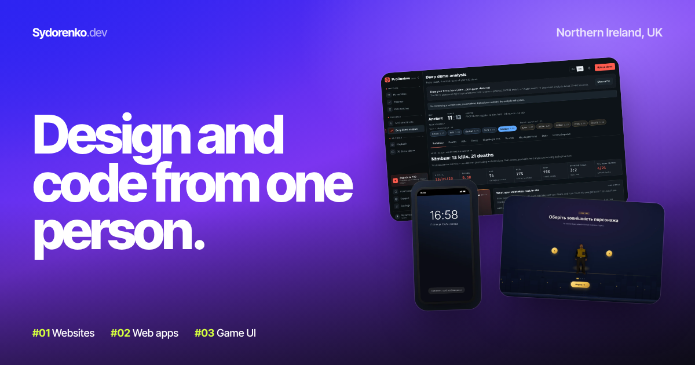

# sydorenkodev.co.uk

Source of my portfolio site.

Static site on Netlify, the contact form goes through Netlify Forms. `site/` is the folder that gets deployed. `python serve.py` runs it locally on port 5530 with the same clean URLs as on the live site.

The concept sites from the portfolio have their own repos: [barbershop](https://github.com/asydorenkodev/barbershop), [clean-gym](https://github.com/asydorenkodev/clean-gym), [silverline-coffee](https://github.com/asydorenkodev/silverline-coffee).
